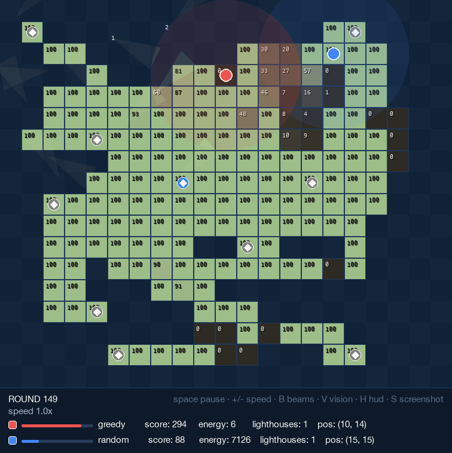
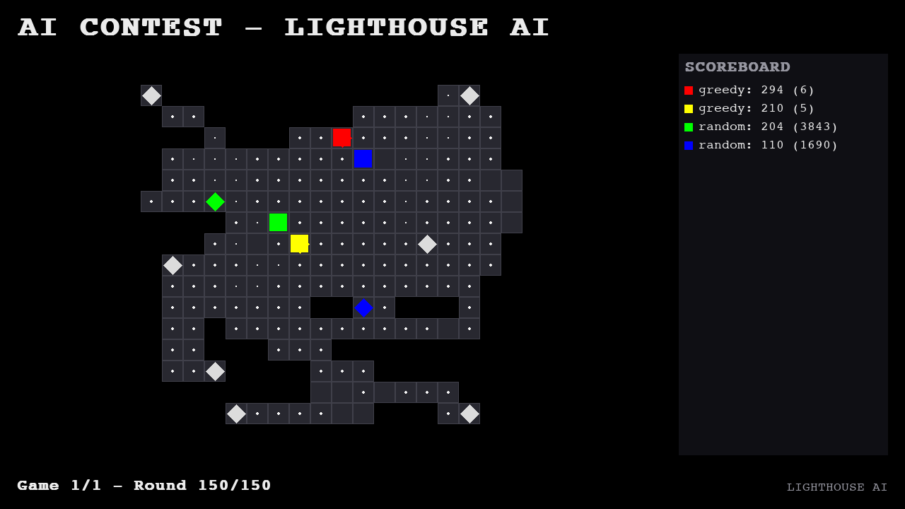
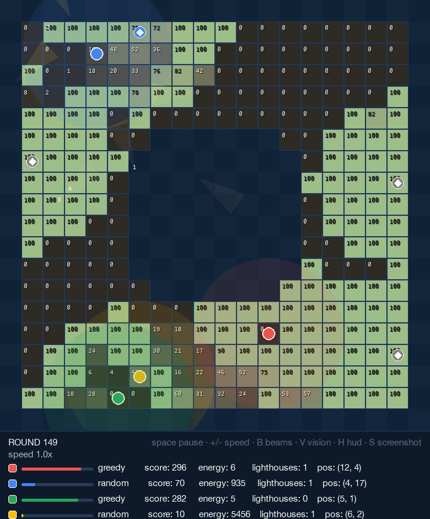

# Lighthouses — FaROS LaSER AI Contest Playground

*[Versión en español](README.es.md)*

Public playground for **FaROS LaSER** (Laser Lighthouses), the multiplayer
strategy game from the **Euskal Encounter AI Contest**
([contest page](https://ee34.euskalencounter.org/software-libre/ai-contest.html),
[original contest repo](https://github.com/marcan/lighthouses_aicontest)).

This repository is the public face of the *Lighthouse AI* project: it ships
everything you need to run the game and write your own bots — the full game
rules, the engine, a set of maps, two example bots, a live pygame viewer and
a headless match runner with statistics.



## The game

Players share a 2D island dotted with lighthouses:

- Lighthouses radiate energy (`floor(5 - distance)`) onto nearby cells every
  round; players harvest the energy of the cell they stand on (split when
  shared).
- Standing on a lighthouse grants its **key**; energy is spent to
  **capture** (attack) or **recharge** lighthouses, and owned lighthouses
  can be **connected** with laser beams (no crossings, one-use key required).
- Three mutually connected lighthouses form a **triangle** that scores its
  area in cells every round — the decisive source of points.
- Lighthouses decay by 10 energy per round; at zero they turn neutral and
  all their connections and triangles break.

Full rules and the bot communication protocol (Spanish):
[`aicontest_spec.txt`](aicontest_spec.txt).

## Quickstart

Live viewer (the only part that needs a dependency, pygame-ce):

```bash
python3 -m venv .venv
.venv/bin/pip install -r requirements.txt
.venv/bin/python ai_contest.py --bots greedy,random
```

Headless match with statistics (pure standard library, nothing to install):

```bash
python3 match.py --bots greedy,random --map maps/island.txt \
    --games 10 --rounds 200 --rotate
```

Viewer controls: `space` pause · `+/-` speed · `B` beams · `V` vision ·
`H` hud · `S` screenshot · `Q`/`Esc` quit. `--presentation` switches to a
1280x720 broadcast view; `--screenshot out.png` saves the final frame.



## Write your own bot

The playground runs Python bots **in process**: copy either example in
`examples/` and subclass `interface.Bot` (`play(state)` returns one of
`move / attack / connect / pass` — see `examples/GreedyBot/greedybot.py`
for a minimal greedy strategy in ~50 lines).

The official contest protocol — JSON messages over stdio, any programming
language, 2 s to initialize and 100 ms per turn — is documented in
[`aicontest_spec.txt`](aicontest_spec.txt) (section *Protocolo*). Bots are
self-contained scripts, so a bot written for this playground only needs a
thin stdio wrapper to compete.

## Baseline stats

Duels between the two example bots, 20 games per map, 200 rounds, seed 42,
rotating seats (`match.py --bots greedy,random --rotate`; raw output in
[`stats/`](stats)):

| Map | Size | Lighthouses | GreedyBot wins | RandBot wins | Greedy mean | Rand mean |
|---|---|---|---|---|---|---|
| grid | 19x18 | 25 | 2 | 18 | 336.9 | 913.2 |
| island | 21x18 | 11 | 4 | 16 | 298.1 | 607.9 |
| square | 8x7 | 4 | 3 | 17 | 277.5 | 709.3 |
| square_l | 12x11 | 4 | 17 | 3 | 357.5 | 181.7 |
| square_xl | 20x19 | 4 | 20 | 0 | 379.9 | 24.8 |
| gen_open_m | 16x12 | 6 | 10 | 10 | 330.1 | 342.0 |
| gen_cross | 21x21 | 5 | 14 | 6 | 308.3 | 242.7 |
| gen_donut | 20x20 | 6 | 17 | 3 | 392.4 | 233.6 |
| gen_ring_l | 30x30 | 10 | 11 | 9 | 349.8 | 369.4 |
| **Total** | | | **98** | **82** | | |

4-player melee on island (2x GreedyBot + 2x RandBot, 20 games): RandBot
seats won 16 games, GreedyBot seats 4. Even a purely random bot is
dangerous on dense maps — harvesting routes and camping one lighthouse are
not enough. Run your own:

```bash
python3 match.py --bots greedy,greedy,random,random --map maps/island.txt --rotate --games 20
```



## Project layout

```
├── aicontest_spec.txt   # Full game rules + bot protocol (Spanish)
├── engine/              # Game engine (simulation + pygame views)
├── examples/
│   ├── RandBot/         # Random example bot (from the original contest)
│   └── GreedyBot/       # Greedy example bot (harvest + capture)
├── maps/                # Classic contest maps + generated variants
├── ai_contest.py        # Live pygame viewer
├── match.py             # Headless match runner with stats
├── docs/img/            # Screenshots
├── stats/               # Raw baseline statistics
└── tests/               # Smoke tests (engine + match runner)
```

## Tests

Standard library only, nothing to install:

```bash
python3 -m unittest discover -s tests -v
```

They play a short seeded duel on every map, a 4-player melee, check that
seeded games are deterministic and that GreedyBot beats RandBot on the
island map, and run `match.py` end to end. CI runs them on every push.

## Credits & license

- Game design, rules and original engine: **Euskal Encounter AI Contest**
  by marcan. `examples/RandBot` is marcan's original example (public domain).
- This playground: *Lighthouse AI* project — MIT License, Jose Lopez
  ([@aifriend](https://github.com/aifriend)). See [LICENSE](LICENSE).
